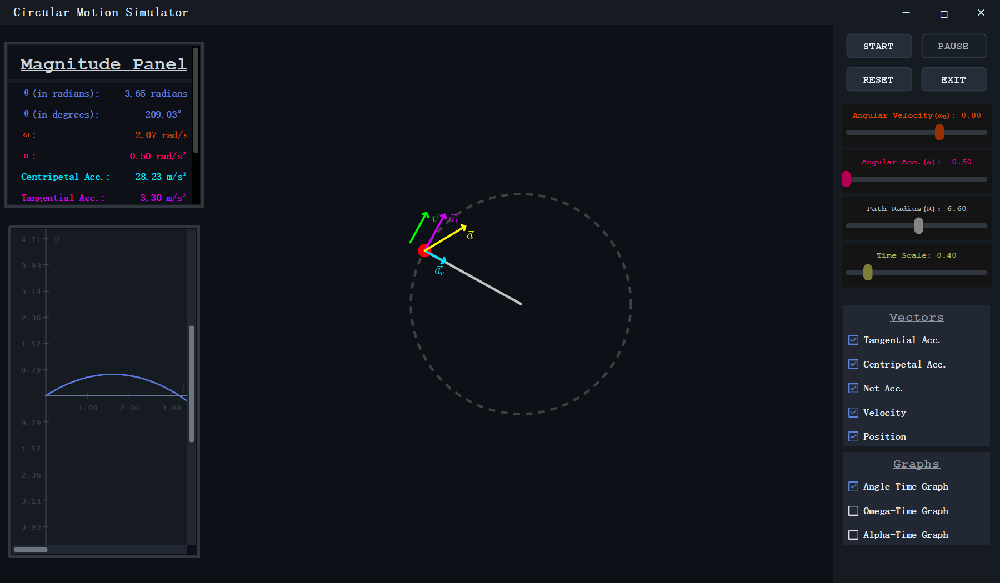

# Circular Motion Simulator

An interactive Java desktop application for studying uniform and non-uniform circular motion through real-time animation, toggleable vector visualization, live physical quantities, and dynamic kinematic graphs.

## Overview

Circular Motion Simulator provides a visual, hands-on way for students curious about physics to explore how angular kinematics translate into linear motion. Instead of treating equations like $\theta(t)$, $\omega(t)$, and $\alpha(t)$ as static formulas, you can adjust initial angular velocity, angular acceleration, path radius, and simulation time scale in real time and immediately see how each vector and graph responds.

## Features

- **Uniform & Non-Uniform Circular Motion:** Simulate constant-speed rotation ($\alpha = 0$) or accelerated circular motion ($\alpha \neq 0$) at ~60 FPS.
- **Toggleable Vector Visualization:** Independently show or hide five vectors rendered on the simulation canvas with LaTeX labels:
    - Tangential Velocity ($\vec{v}$)
    - Centripetal Acceleration ($\vec{a}_c$)
    - Tangential Acceleration ($\vec{a}_t$)
    - Net / Resultant Acceleration ($\vec{a}$)
    - Position Vector (center to particle)
- **Live Magnitude Panel:** A scrollable readout tracking nine real-time physical quantities:
    - Angular displacement $\theta$ (in both radians and degrees)
    - Angular velocity $\omega$ ($\text{rad/s}$)
    - Angular acceleration $\alpha$ ($\text{rad/s}^2$)
    - Centripetal acceleration ($\text{m/s}^2$)
    - Tangential acceleration ($\text{m/s}^2$)
    - Ball position / path radius ($\text{m}$)
    - Linear velocity ($\text{m/s}$)
    - Time scale ($\times$)
- **Interactive Kinematic Graphs:** Switch between **Angle–Time ($\theta$-$t$)**, **Omega–Time ($\omega$-$t$)**, and **Alpha–Time ($\alpha$-$t$)** graphs, and scroll across the $1000 \times 1000$ plotting canvas to inspect values over time.
- **Real-Time Parameter Sliders:**
    - Initial Angular Velocity ($\omega_0$): $-2.50$ to $2.50\text{ rad/s}$
    - Angular Acceleration ($\alpha$): $-0.50$ to $0.50\text{ rad/s}^2$
    - Path Radius ($R$): $3.00$ to $10.00\text{ m}$
    - Time Scale: $0.20\times$ to $1.50\times$
- **Simulation State Controls:** `START`, `PAUSE`, `RESET`, and `EXIT` buttons for full playback control.

## Screenshot



*Main application window showing the live Magnitude Panel and scrollable $\theta$-$t$ graph (left), the circular path with active $\vec{v}$, $\vec{a}_t$, $\vec{a}_c$, $\vec{a}$, and position vectors (center), and simulation controls, sliders, and vector/graph toggles (right).*

## Technologies Used

- **Java (JDK 25)**
- **Java Swing & AWT** — Custom-decorated window, layout panels, custom sliders/scrollbars, and 2D anti-aliased graphics rendering
- **JLaTeXMath (`jlatexmath-1.0.7.jar`)** — Crisp LaTeX rendering for vector labels ($\vec{v}, \vec{a}_c, \vec{a}_t, \vec{a}$) and graph axes ($t, \theta, \omega, \alpha$)

## Architecture and Project Structure

The application uses a three-panel `BorderLayout` inside an undecorated `SimFrame` (`InfoPanel` on the left, `SimPanel` in the center, and `ControlPanel` on the right), driven by a `javax.swing.Timer` firing every `16 ms`:

```text
Circular-Motion-Simulator/
├── lib/
│   └── jlatexmath-1.0.7.jar       # LaTeX rendering library
├── resource/
│   ├── images/                    # Custom checkbox state icons
│   └── META-INF/
│       └── MANIFEST.MF            # JAR entry-point manifest (Main-Class: CircularMotionSim)
├── src/
│   ├── CircularMotionSim.java     # Application entry point
│   ├── SimFrame.java              # Main window, custom title bar, and ~60 FPS timer loop
│   ├── SimPanel.java              # Central 2D canvas for path, particle, and vectors
│   ├── InfoPanel.java             # Live Magnitude Panel and kinematic Graph views
│   ├── ControlPanel.java          # Playback buttons (START, PAUSE, RESET, EXIT)
│   ├── SliderPanel.java           # Parameter sliders (ω₀, α, R, Time Scale)
│   ├── CheckBoxPanel.java         # Vector visibility and graph-selection checkboxes
│   ├── physics/
│   │   └── Physics.java           # Kinematics state, integration, and vector calculations
│   └── utils/
│       ├── CustomButton.java      # Styled button component
│       ├── CustomTime.java        # Nanosecond delta-time and time-scale manager
│       ├── Graph.java             # Scrollable JScrollPane wrapper for graphs
│       ├── GraphPanel.java        # Coordinate axes, tick marks, and curve plotter
│       ├── Latex.java             # JLaTeXMath TeXIcon helper
│       ├── ScrollBars.java        # Custom scrollbar styling
│       ├── SimColors.java         # Centralized dark-theme color palette
│       ├── SimFonts.java          # Centralized font definitions
│       ├── Slider.java            # Custom slider component wrapper
│       └── Vector.java            # 2D vector arrow and LaTeX label renderer
└── Circular Motion Simulator.iml  # IntelliJ IDEA module configuration
```

## Technical Details

### Kinematics & Integration (`Physics.java` & `CustomTime.java`)
On each timer tick, `CustomTime` computes the elapsed time $\Delta t$ using `System.nanoTime()`, caps it at $0.1\text{ s}$ to prevent large jumps if the window is minimized or paused, and multiplies it by the active `timeScale`. The simulation updates angular state using semi-implicit Euler integration:

$$\omega_{n+1} = \text{clamp}(\omega_n + \alpha \Delta t,\ -5,\ 5)\text{ rad/s}$$

$$\theta_{n+1} = (\theta_n + \omega_{n+1} \Delta t) \bmod 2\pi$$

The particle's Cartesian position and acceleration magnitudes are computed from:

$$x = R\cos\theta, \quad y = R\sin\theta$$

$$v = R|\omega|, \quad a_c = R\omega^2, \quad a_t = R|\alpha|, \quad a = \sqrt{a_c^2 + a_t^2}$$

### Kinematic Graphs (`InfoPanel.java`)
The three switchable graphs plot the analytical kinematic functions over time $t$:
- **Angle–Time:** $\theta(t) = \theta_0 + \omega_0 t + \frac{1}{2}\alpha t^2$
- **Omega–Time:** $\omega(t) = \omega_0 + \alpha t$
- **Alpha–Time:** $\alpha(t) = \alpha$

## Installation

### Windows (Recommended)

1. Visit the [Releases](https://github.com/subhanshu0207/Circular-Motion-Simulator/releases) page.
2. Download the latest **Circular Motion Simulator.exe** from the Assets section.
3. Run the executable to launch the application.

### Build and Run from Source
**Prerequisites:**
- **Java Development Kit (JDK) 25** (required for the compact `static void main()` entry point in `CircularMotionSim.java`)

1. **Clone the repository:**
   ```bash
   git clone [https://github.com/subhanshu0207/Circular-Motion-Simulator.git](https://github.com/subhanshu0207/Circular-Motion-Simulator.git)
   cd Circular-Motion-Simulator
   ```

2. **Compile the source files:**
    - **Windows (Command Prompt / PowerShell):**
      ```bash
      javac -cp "lib/jlatexmath-1.0.7.jar" -d out src/*.java src/physics/*.java src/utils/*.java
      ```
    - **macOS / Linux:**
      ```bash
      javac -cp "lib/jlatexmath-1.0.7.jar" -d out src/*.java src/physics/*.java src/utils/*.java
      ```

3. **Run the application** (include `out`, `lib/jlatexmath-1.0.7.jar`, and `resource` on the classpath):
    - **Windows:**
      ```bash
      java -cp "out;lib/jlatexmath-1.0.7.jar;resource" CircularMotionSim
      ```
    - **macOS / Linux:**
      ```bash
      java -cp "out:lib/jlatexmath-1.0.7.jar:resource" CircularMotionSim
      ```

## Usage Instructions

1. **Set Initial Parameters:** Use the sliders on the right panel to configure initial angular velocity ($\omega_0$), angular acceleration ($\alpha$), path radius ($R$), and time scale.
2. **Choose Vectors & Graph:** Toggle any combination of vectors under **Vectors**, and select one of the three kinematic graphs under **Graphs**.
3. **Run the Simulation:** Click **START** to begin motion, **PAUSE** to freeze at any instant, **RESET** to restore default values, or **EXIT** to close the application.
4. **Inspect Data:** Scroll through the **Magnitude Panel** to read live values or scroll across the **Graph** panel to examine the plotted curve over time.

## License

This project is licensed under the terms specified in the [LICENSE](LICENSE) file.

## Author

**Subhanshu** — [GitHub](https://github.com/subhanshu0207)